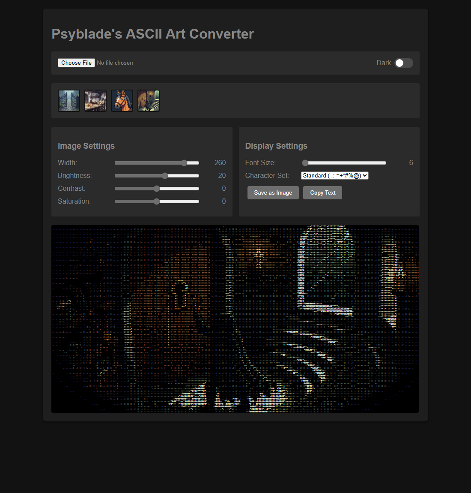
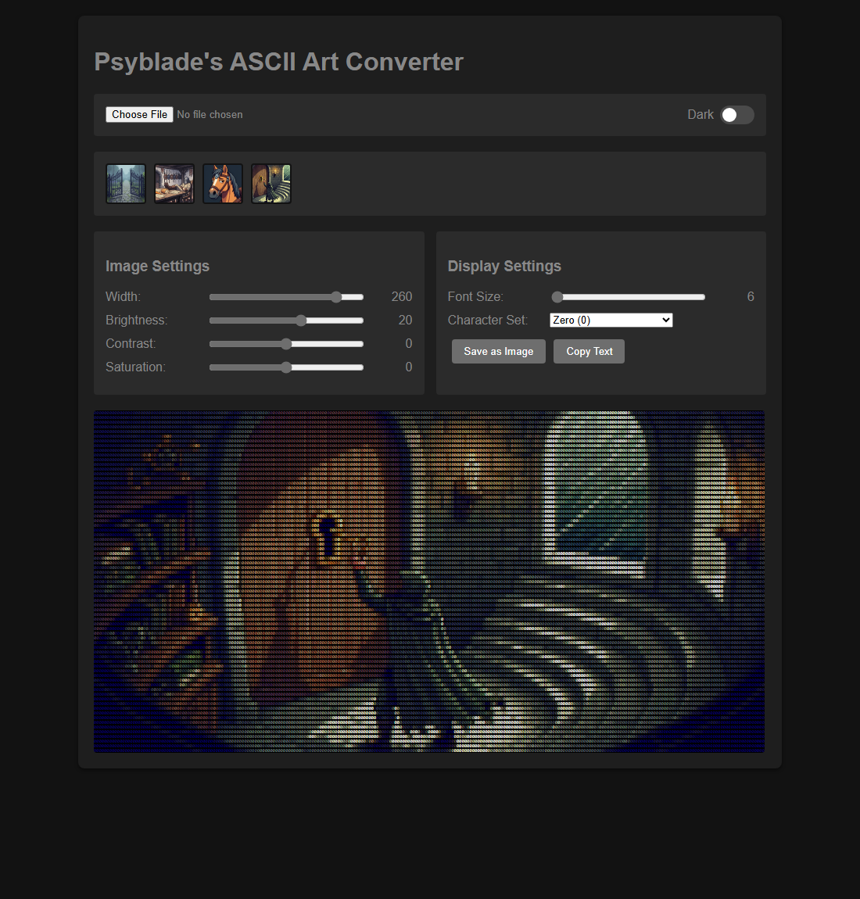

# Psyblade's ASCII Art Converter

Turn any image into ASCII art, entirely in the browser. No uploads, no server, no dependencies to install — just a static page.

**Live demo:** https://psyblade.github.io/ascii_art_convertor/



## Features

- **Load any image** with *Choose File*, or click one of the sample thumbnails
- **9 character sets** — from classic density ramps to single-glyph mosaics
- **Live controls** — width, brightness, contrast, saturation and font size all re-render as you drag
- **Per-pixel colour** — every character is painted with the colour of the pixel it stands for
- **Light / dark theme** toggle
- **Save as Image** (PNG) or **Copy Text**

Compare the default single-glyph mosaic with the classic character ramp:

| Default — `Zero (0)` | `Standard ( .:-=+*#%@)` |
|---|---|
|  |  |

## Getting started

Open `index.html` in a browser. That's the whole setup.

The sample thumbnails are loaded from `imgs/` by URL, and browsers block canvas pixel access for images loaded over `file://`. So the sample bar only converts when the page is served over HTTP:

```bash
python -m http.server 8000
# then open http://localhost:8000/
```

*Choose File* works either way, because those files come through the file picker.

## Character sets

| Set | Characters | Notes |
|---|---|---|
| `Standard` | ` .:-=+*#%@` | Classic density ramp, lightest to darkest ink |
| `Blocks` | ` ░▒▓█` | Same ramp using block elements |
| `Binary` | `01` | Two-tone dither |
| `Solid` | `█` | Solid fill — colour carries the image |
| `Round` | `●` | Round bullet mosaic |
| `Dot` | `•` | Fine dot screen |
| `Ring` | `○` | Hollow circles |
| `At` | `@` | Classic terminal character |
| `Zero` | `0` | Default; a mosaic of zeros |

Single-glyph sets always resolve to the same character, so brightness drives colour rather than glyph density.

## Build

`dist/` contains the minified + obfuscated build that is published to GitHub Pages. It is generated, not edited by hand:

```bash
cd build
npm install
npm run build     # writes ../dist
```

The build obfuscates each page's inline JavaScript (`javascript-obfuscator`), minifies the HTML and CSS (`html-minifier-terser`), copies `imgs/` through, and adds `.nojekyll`.

Obfuscation is configured moderately on purpose: `controlFlowFlattening` and `deadCodeInjection` are off, and the string array uses plain encoding rather than base64, because those settings measurably slowed the per-pixel conversion loop.

## Project layout

| Path | Purpose |
|---|---|
| `index.html` | Main page (dark theme) |
| `dark.html` | Dark theme entry point |
| `light.html` | Light theme entry point |
| `imgs/` | Sample images for the thumbnail bar |
| `build/` | Build tooling that produces `dist/` |
| `dist/` | Generated output published to GitHub Pages |

## License

[MIT](LICENSE) — covers the source code.

The sample images in `imgs/` are demo assets and are not covered by the MIT license.

Saving to PNG uses [html2canvas](https://html2canvas.hertzen.com/), loaded from a CDN at runtime.
